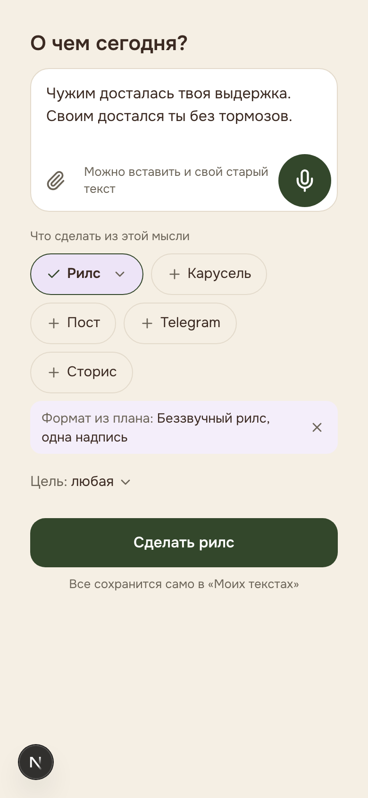
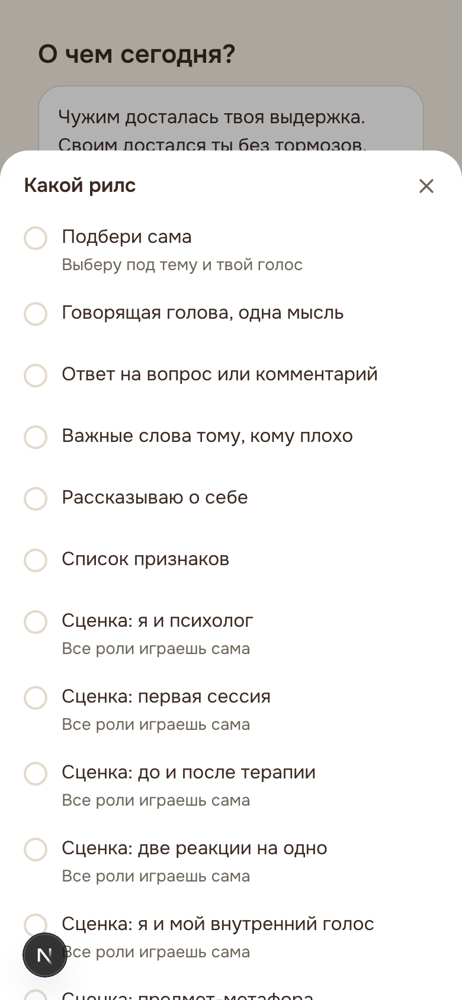
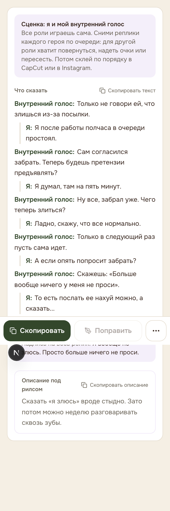
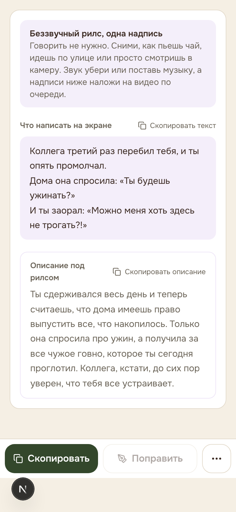
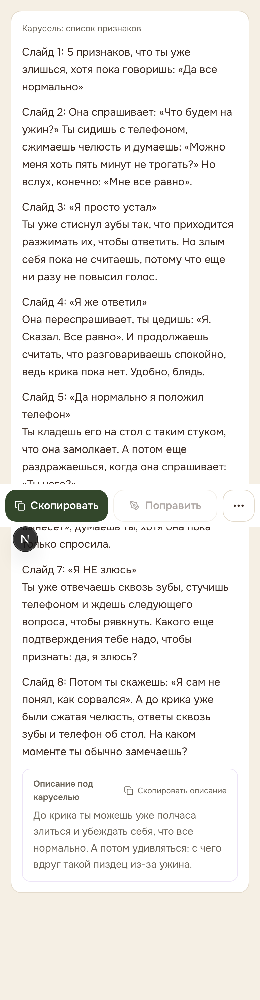
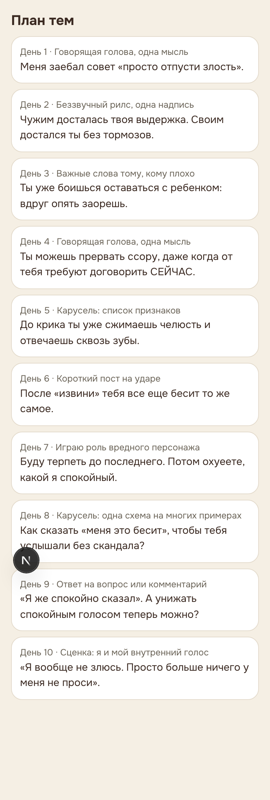

# zh6 готов к включению на тестовом аккаунте

Это короткий итог по подготовке zh6 к проду. Ничего не выкатила, не запушила и не смержила. Сервер и базу не трогала.

## Что готово

zh6 перенесен в отдельную чистую ветку от main. Там только он. Пока zh6 не включен на сервере, все работает ровно как сейчас в проде. Это я проверила побайтно: старый генератор собирает те же самые промпты, что и в main.

Когда zh6 включен, он работает только у аккаунтов с новым мозгом, то есть сейчас только у твоего тестового.

Закрыты все дыры из плана выкатки:

- Сторис остаются сторис, пост для Telegram остается постом для Telegram.
- Рилсы сохраняются своим видом: говорящая голова, сценка, только надписи. Экран показывает каждый вид как надо. В сценке у каждой роли своя строка, вторая роль отмечена линией. В рилсе с надписями они идут плашками по очереди.
- В плане тем у каждого дня видно, какой это формат. План собирается пачками по 10 дней.
- Кнопка дня в плане открывает «Сделать» сразу с этим форматом и задачей. Ситуация из подсказки дня тоже доходит до текста. На «Сделать» вид можно выбрать и самой: у включенного рилса, карусели или поста появляется стрелочка.
- «Поправить» не ломает разметку. Если правка сломала бы роли сценки или надписи, текст остается как был, и экран спокойно об этом говорит.
- «Другой заход» пишет новый текст целиком. Он сохраняется, когда ты его выбираешь, и считается как обычный текст.
- «Пока без видео» значит, что форматов, где ты в кадре, не будет.
- Мат: сначала твой выбор на экране голоса, потом вариант «Иногда», потом твои тексты.
- Кодовое слово берется только из профиля. Если его нет, будет просто «напишите мне в директ». На экране голоса появились поле «Кодовое слово» и переключатель звездочек в мате. Их видит только тот, у кого включен zh6.
- В Instagram при задаче «запись» приглашение остается, как ты решила 26.10. Цены, скидки, «успей», «осталось мест» и отзывы по-прежнему вырезаются.

Правки текста:

- Запрет «никогда» остался только на то, чего у живых психологов нет совсем. Остальные живые приемы теперь не чаще раза у автора.
- Пометок художника внутри текста нет.
- Карусель-история рассказывается в третьем лице, без слайда-лекции на «ты».
- Один адресат и один род, и в каруселях тоже.

## Что не готово или осталось

- Проверить через вход в аккаунт я не могла: локальный запуск пишет в боевую базу, а войти за тебя нельзя. Поэтому каждый вид я сгенерировала тем же кодом, что вызывают экраны, и показала на странице предпросмотра. Она есть только в разработке. Первые настоящие генерации на тестовом аккаунте будут первой живой проверкой.
- «Поправить» и план тем не ограничены по числу, как и сейчас в main. Перед тем как давать zh6 всем, нужен ограничитель.
- Вид выбирается для одного формата за раз.
- Миграция для кодового слова и звездочек лежит файлом и не применена. Без нее все работает.

Вопросы по этим пунктам в файле ВОПРОСЫ-АРИНЕ.md, их шесть. Главный второй: что проверить на сервере перед включением.

## Как это выглядит

Экран «Сделать» с форматом из плана:



Выбор вида рилса:



Сценка:



Рилс только надписями:



Карусель:



План тем с форматами:



Остальные скриншоты (пост, Telegram, сторис, после «Поправить», старый генератор, и все то же на компьютере) лежат в той же папке _знания/мозг-генератора/zh6/prod-check/.

## Деньги

Потрачено 9.67 ₽ из 50. Это одна живая проверка: план тем, по одному материалу каждого вида, одно «Поправить» и одна генерация старым генератором. Остальное проверяла бесплатно, тестами без сети.

## Как включить только на тестовом аккаунте

Порядок такой.

1. Ты пишешь мне «да».
2. Я сливаю ветку feat/zh6-prod в main и пушу. На сайте после этого ничего не меняется, пока zh6 не включен.
3. Дальше ты на сервере. Сначала заходишь и обновляешь сайт как обычно:

```
bash /var/www/psycont/update.sh
```

4. Проверяешь, у кого включен новый мозг:

```
grep -E "NEW_GENERATION_PIPELINE|PROMPT_HYP" /var/www/psycont/.env
```

Должно быть NEW_GENERATION_PIPELINE=on. Строки с PROMPT_HYP быть не должно. Если там all или PROMPT_HYP уже есть, остановись и напиши мне.

5. Включаешь zh6 и перезапускаешь только PsyCont:

```
echo 'PROMPT_HYP=zh6' >> /var/www/psycont/.env && pm2 restart psycont --update-env
```

6. Проверяешь. Открой psycont.ru под тестовым аккаунтом. На «Сделать» у включенного рилса должна появиться стрелочка выбора вида. Сделай один рилс и один пост. В плане тем нажми «Составить план»: у дней должны быть названия форматов. Учти, что новый план заменит старый план тестового аккаунта.

Если что-то не так, откат одной командой. Она выключает zh6, и все возвращается как было:

```
sed -i '/^PROMPT_HYP=/d' /var/www/psycont/.env && pm2 restart psycont --update-env
```

Красное правило: на сервере рядом работает Razbor. Его процессы (razbor-bot, scraper, web, worker), порты 3000 и 8080, его nginx и сертификаты не трогаем. Сервер не перезагружаем. Перезапускаем только psycont.
